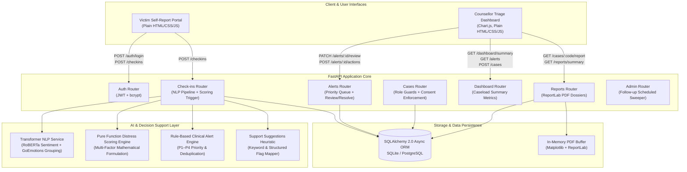
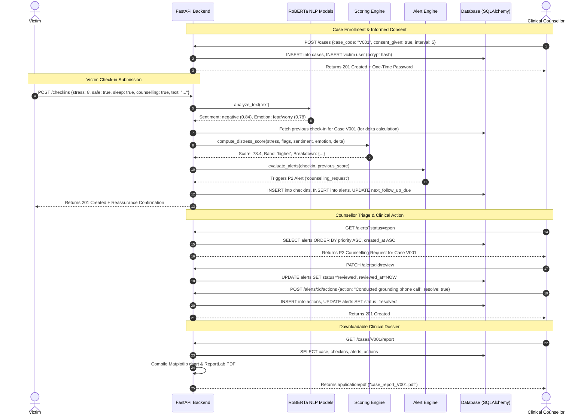

# System Architecture & Data Flow

## 1. System Component Architecture

---

## 2. End-to-End Data Flow

---

## 3. Case V001 Clinical Workflow Walkthrough

Case **V001** illustrates the dynamic escalation of an individual navigating post-trauma legal processes:

### Check-in 1: Baseline Stability (Day -10)
- **Input**: Stress 5/10, `feels_safe=True`, `faces_threat=False`, `sleep_difficulty=False`, `wants_counselling=False`. Text: *"Managing daily routines okay. Experiencing mild fatigue at work, but generally coping with tasks."*
- **NLP Analysis**: Neutral sentiment, low emotional activation.
- **Scoring Output**: Score = `15.0` (Low band). Points breakdown: Stress (15.0), Safety (0.0), Sleep (0.0), Counselling (0.0).
- **Outcome**: No alerts triggered. Case remains on routine 5-day monitoring schedule.

### Check-in 2: Acute Escalation & Sleep Disturbance (Day -5)
- **Input**: Stress 7/10, `sleep_difficulty=True`, text: *"Waking up multiple times at night with persistent worry and intrusive thoughts about the upcoming legal hearing. Feeling tense throughout the day."*
- **NLP Analysis**: RoBERTa identifies negative sentiment and `fear/worry` emotion.
- **Scoring Output**: Score jumps to `50.0` (Moderate band). Sleep points (+5) activated. Delta point adjustment applied (+10 for $\Delta \ge 15$).
- **Outcome**: The longitudinal trendline reflects an upward risk vector. Counsellor monitors case trajectory.

### Check-in 3: Direct Request for Clinical Intervention (Day -1)
- **Input**: Stress 8/10, `sleep_difficulty=True`, `wants_counselling=True`. Text: *"The anxiety is feeling overwhelming this week. I am having panic symptoms in crowds and would really appreciate speaking to a counsellor as soon as possible."*
- **NLP Analysis**: High confidence negative sentiment; elevated panic/worry markers.
- **Scoring Output**: Score = `46.0` (Moderate/Elevated). Counselling points (+5) added.
- **Alert Engine Trigger**:
  - Rule 2 (`counselling_request`) triggered with Priority **P2 (Urgent)**.
  - Reason: *"Individual explicitly requested psychological/support counselling."*
- **Support Suggestion Engine**: Automatically flags `Psychological Support & Counselling` and `Sleep Hygiene & Somatic Care`.
- **Counsellor Action**:
  1. Counsellor observes P2 alert in queue.
  2. Marks alert as `reviewed`.
  3. Conducts clinical telephone consultation and schedules an in-person grounding session.
  4. Logs action note and resolves alert.
- **Reporting**: Downloads PDF dossier (`GET /cases/V001/report`) documenting the complete trajectory from initial intake to resolution.
