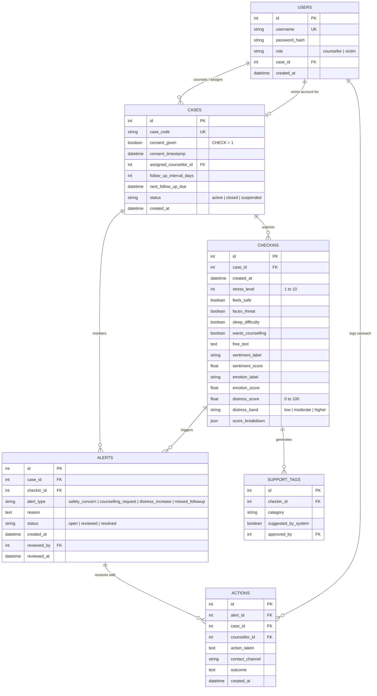

# Database Schema Documentation

## Overview & Privacy Design Principles
The **Mental Health Monitoring (MHM)** system is architected for strict data minimisation and safeguarding:
- **Zero Personally Identifiable Information (PII)**: No real names, national identification numbers, addresses, contact details, or location logs are stored anywhere in the database.
- **Pseudonymous Case Identifiers**: Each individual is referenced solely by a pseudonymous case code (e.g. `V001`, `V002`), assigned by their clinical counsellor.
- **Explicit Consent Mandate**: Case creation strictly enforces consent at two separate defensive layers:
  1. *Application Layer*: Pydantic validator rejecting `consent_given != True` with HTTP 422 before touching the database.
  2. *Database Layer*: SQL Check Constraint `CONSTRAINT ck_cases_consent CHECK (consent_given = 1 OR consent_given = true)`.
- **Role Isolation & Access Scoping**:
  - `counsellor`: Access restricted strictly to cases where `assigned_counsellor_id == current_user.id`.
  - `victim`: Access restricted strictly to their own single linked `case_id`.

---

## Entity Relationship Diagram (ERD)

---

## Detailed Table Specifications

### 1. `users` Table
Stores authentication credentials for both administrative counsellors and pseudonymous victim accounts.

| Column | Type | Constraints | Description |
|---|---|---|---|
| `id` | `INTEGER` | `PRIMARY KEY AUTOINCREMENT` | Unique internal user ID. |
| `username` | `VARCHAR(80)` | `NOT NULL, UNIQUE, INDEX` | Unique login identifier (e.g. `admin_counsellor`, `v_v001`). |
| `password_hash` | `VARCHAR(128)` | `NOT NULL` | One-way salted hash (bcrypt). Plaintext is never stored. |
| `role` | `VARCHAR(10)` | `NOT NULL` | Access control role: `'counsellor'` or `'victim'`. |
| `case_id` | `INTEGER` | `NULLABLE, FK -> cases(id)` | Linked case if role is victim; NULL for counsellors. |
| `created_at` | `DATETIME` | `NOT NULL, DEFAULT CURRENT_TIMESTAMP` | Account creation timestamp. |

---

### 2. `cases` Table
Maintains the clinical casework metadata and follow-up schedules.

| Column | Type | Constraints | Description |
|---|---|---|---|
| `id` | `INTEGER` | `PRIMARY KEY AUTOINCREMENT` | Internal primary key. |
| `case_code` | `VARCHAR(20)` | `NOT NULL, UNIQUE, INDEX` | Pseudonymous external identifier (e.g. `V001`). |
| `consent_given` | `BOOLEAN` | `NOT NULL, CHECK (consent_given = 1)` | Mandatory informed consent flag. |
| `consent_timestamp` | `DATETIME` | `NULLABLE` | Timestamp when consent was recorded. |
| `assigned_counsellor_id`| `INTEGER` | `NULLABLE, FK -> users(id)` | Counsellor responsible for managing this case. |
| `follow_up_interval_days`| `INTEGER` | `NOT NULL, DEFAULT 7` | Cadence interval in days for expected check-ins. |
| `next_follow_up_due` | `DATETIME` | `NULLABLE` | Calculated deadline for the next check-in. |
| `status` | `VARCHAR(9)` | `NOT NULL, DEFAULT 'active'` | Case state: `'active'`, `'closed'`, `'suspended'`. |
| `created_at` | `DATETIME` | `NOT NULL, DEFAULT CURRENT_TIMESTAMP` | Case enrollment timestamp. |

---

### 3. `checkins` Table
Stores self-reported check-in data, NLP inference outputs, and the transparent score breakdown.

| Column | Type | Constraints | Description |
|---|---|---|---|
| `id` | `INTEGER` | `PRIMARY KEY AUTOINCREMENT` | Check-in identifier. |
| `case_id` | `INTEGER` | `NOT NULL, FK -> cases(id) ON DELETE CASCADE` | Associated case. |
| `created_at` | `DATETIME` | `NOT NULL, DEFAULT CURRENT_TIMESTAMP` | Check-in timestamp (UTC). |
| `stress_level` | `INTEGER` | `NOT NULL, CHECK (1 <= stress_level <= 10)` | Self-reported stress scale. |
| `feels_safe` | `BOOLEAN` | `NOT NULL` | True if victim reports feeling safe in current surroundings. |
| `faces_threat` | `BOOLEAN` | `NOT NULL` | True if active intimidation or threat is reported. |
| `sleep_difficulty` | `BOOLEAN` | `NOT NULL` | True if persistent insomnia or night waking reported. |
| `wants_counselling` | `BOOLEAN` | `NOT NULL` | Explicit request for psychological consultation. |
| `free_text` | `TEXT` | `NULLABLE` | Optional open-ended reflection or context. |
| `sentiment_label` | `VARCHAR(20)`| `NULLABLE` | RoBERTa sentiment output: `positive`, `neutral`, `negative`. |
| `sentiment_score` | `FLOAT` | `NULLABLE` | Confidence probability [0.0, 1.0]. |
| `emotion_label` | `VARCHAR(30)`| `NULLABLE` | GoEmotions grouped classification. |
| `emotion_score` | `FLOAT` | `NULLABLE` | Confidence probability [0.0, 1.0]. |
| `distress_score` | `FLOAT` | `NULLABLE` | Composite computed score [0.0, 100.0]. |
| `distress_band` | `VARCHAR(20)`| `NULLABLE` | Risk category: `'low'`, `'moderate'`, `'higher'`. |
| `score_breakdown` | `JSON` | `NULLABLE` | Explainable point contributions dictionary. |

---

### 4. `alerts` Table
Records triage notifications generated by the alert rule engine.

| Column | Type | Constraints | Description |
|---|---|---|---|
| `id` | `INTEGER` | `PRIMARY KEY AUTOINCREMENT` | Alert identifier. |
| `case_id` | `INTEGER` | `NOT NULL, FK -> cases(id) ON DELETE CASCADE` | Affected case. |
| `checkin_id` | `INTEGER` | `NULLABLE, FK -> checkins(id) ON DELETE SET NULL` | Triggering check-in (NULL for missed follow-up). |
| `alert_type` | `VARCHAR(50)`| `NOT NULL` | Alert rule ID (`safety_concern`, `counselling_request`, etc.). |
| `reason` | `TEXT` | `NOT NULL` | Clinical justification and evidence string. |
| `status` | `VARCHAR(8)` | `NOT NULL, DEFAULT 'open'` | Lifecycle state: `'open'`, `'reviewed'`, `'resolved'`. |
| `created_at` | `DATETIME` | `NOT NULL, DEFAULT CURRENT_TIMESTAMP` | Alert creation timestamp. |
| `reviewed_by` | `INTEGER` | `NULLABLE, FK -> users(id)` | Counsellor ID who reviewed the notification. |
| `reviewed_at` | `DATETIME` | `NULLABLE` | Timestamp when marked as reviewed. |

---

### 5. `actions` Table
Maintains an immutable audit log of clinical interventions and follow-ups conducted by counsellors.

| Column | Type | Constraints | Description |
|---|---|---|---|
| `id` | `INTEGER` | `PRIMARY KEY AUTOINCREMENT` | Action identifier. |
| `alert_id` | `INTEGER` | `NOT NULL, FK -> alerts(id) ON DELETE CASCADE` | Associated alert. |
| `case_id` | `INTEGER` | `NOT NULL, FK -> cases(id) ON DELETE CASCADE` | Affected case. |
| `counsellor_id` | `INTEGER` | `NOT NULL, FK -> users(id)` | Counsellor who performed outreach. |
| `action_taken` | `TEXT` | `NOT NULL` | Clinical intervention notes and support actions. |
| `contact_channel`| `VARCHAR(50)`| `NULLABLE` | Outreach medium (Phone, In-person, Secure messaging). |
| `outcome` | `TEXT` | `NULLABLE` | Result of intervention or follow-up plan. |
| `created_at` | `DATETIME` | `NOT NULL, DEFAULT CURRENT_TIMESTAMP` | Action logging timestamp. |

---

### 6. `support_tags` Table
Stores multidisciplinary support suggestions flagged by the decision engine.

| Column | Type | Constraints | Description |
|---|---|---|---|
| `id` | `INTEGER` | `PRIMARY KEY AUTOINCREMENT` | Support tag ID. |
| `checkin_id` | `INTEGER` | `NOT NULL, FK -> checkins(id) ON DELETE CASCADE` | Originating check-in. |
| `category` | `VARCHAR(80)`| `NOT NULL` | Category (e.g. Legal, Housing, Somatic, Psychological). |
| `suggested_by_system`| `BOOLEAN`| `NOT NULL, DEFAULT TRUE` | Indicates automated recommendation. |
| `approved_by` | `INTEGER` | `NULLABLE, FK -> users(id)` | Counsellor confirming recommendation relevance. |

---

## SQL DDL Export
The full raw ANSI SQL definition is exported in [`docs/schema.sql`](file:///c:/Users/Mr.Vineeth/OneDrive/Desktop/megha%20mam/docs/schema.sql).
