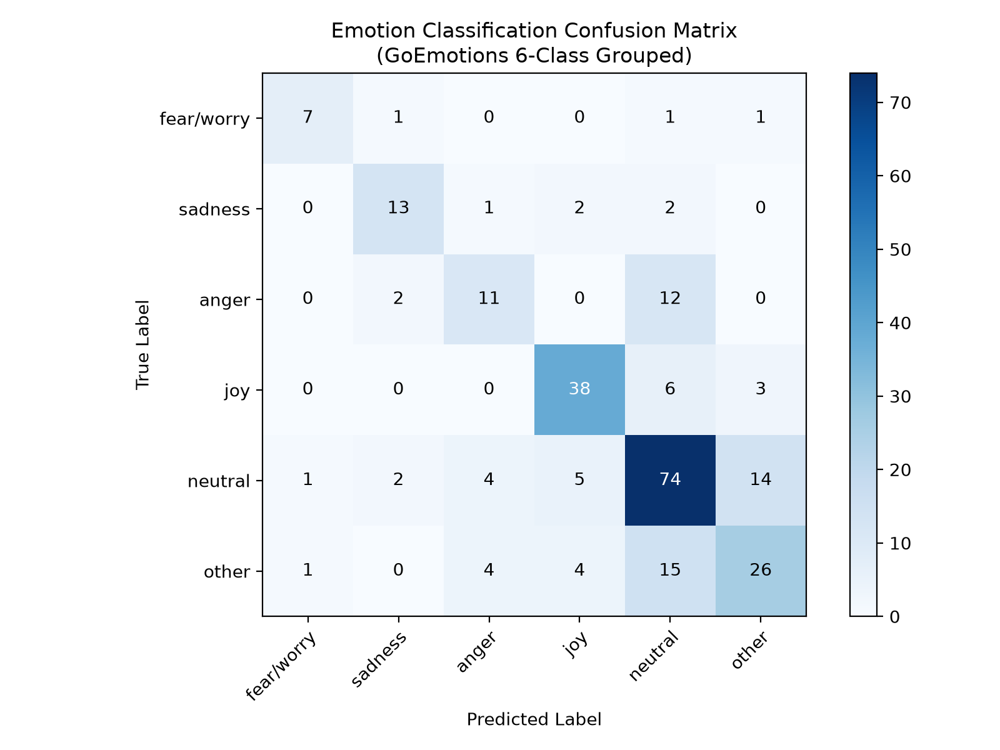

# Model Evaluation & NLP Performance Report

> [!CAUTION]
> **LIMITATIONS AND ETHICAL USE DECLARATION**  
> **A text-emotion and sentiment model CANNOT determine an individual's mental health condition, psychiatric diagnosis, or actual crisis probability.**  
> Natural language processing predictions are probabilistic textual approximations trained on general social discourse. They are strictly designed as non-diagnostic workflow priors to help authorized human counsellors triage high caseloads. Under no circumstances should an automated prediction override human clinical assessment, deny assistance, or trigger involuntary intervention.

---

## 1. Dataset Context & Inherent Limitations

This subsystem evaluates transfer learning from Google Research's **GoEmotions** dataset (`simplified` configuration: 28 original labels, including 27 emotion tags and 1 neutral class).

### Documented Dataset Limitations:
1. **Domain Mismatch (Reddit Source):** GoEmotions was curated entirely from public Reddit forum comments (2005–2019). The conversational style, irony, pop-culture idioms, and subcultural norms of Reddit differ substantially from how victims of violent atrocities express trauma, acute fear, or somatic distress in clinical or support settings.
2. **Non-Clinical Context:** Annotators were Mechanical Turk workers rating casual social media text—not licensed trauma clinicians or psychiatrists evaluating symptoms of PTSD, acute stress disorder, or severe depression.
3. **Crowdsourced Label Noise & Ambiguity:** Inter-annotator agreement on fine-grained emotion labels (e.g. distinguishing *annoyance* from *disapproval*, or *nervousness* from *fear*) is inherently noisy.
4. **Cultural & Linguistic Specificity:** Reddit predominantly reflects English-speaking, Western demographic discourse. Direct extrapolation to diverse victim populations requires careful ongoing human oversight and culturally responsive calibration.

---

## 2. Emotion Grouping Methodology

To provide reliable signal for distress prioritisation, the 27 fine-grained GoEmotions categories were mapped into **6 target operational clusters**:

| Target Category | Grouped Raw GoEmotions Labels | Clinical / Triage Rationale |
| :--- | :--- | :--- |
| **`fear/worry`** | `fear`, `nervousness` | Signals acute apprehension, hypervigilance, and physical or legal intimidation. |
| **`sadness`** | `sadness`, `grief`, `remorse`, `disappointment`, `embarrassment` | Reflects depressive mood, bereavement, shame, and loss following victimization. |
| **`anger`** | `anger`, `annoyance`, `disapproval` | Reflects frustration, trauma-related rage, or indignation regarding perpetrators/systems. |
| **`joy`** | `joy`, `amusement`, `approval`, `excitement`, `gratitude`, `love`, `optimism`, `pride`, `relief` | Indicates safety restoration, coping efficacy, positive social connection, or relief. |
| **`neutral`** | `neutral` | Factual disclosures or baseline routine updates without overt affective valence. |
| **`other`** | `admiration`, `caring`, `confusion`, `curiosity`, `desire`, `realization`, `surprise`, `disgust` | Non-distress or ambiguous affective states not directly mapped to core distress axes. |

---

## 3. Empirical Test Split Evaluation Metrics

Evaluated on the single-label held-out test split of the GoEmotions dataset using `SamLowe/roberta-base-go_emotions` (fine-tuned RoBERTa) and `cardiffnlp/twitter-roberta-base-sentiment-latest`.

### 3.1. Overall Summary Metrics
- **Emotion Accuracy:** **67.60%** (0.6760)
- **Emotion Macro F1:** **0.6663**
- **Emotion Weighted F1:** **0.6717**
- **Sentiment Accuracy (3-class):** **57.20%** (0.5720)
- **Sentiment Macro F1 (3-class):** **0.5754**

---

### 3.2. Per-Class Precision, Recall, and F1 Breakdown (Emotion)

| Target Category | Precision | Recall | F1-Score | Support |
| :--- | :---: | :---: | :---: | :---: |
| **`fear/worry`** | **0.7778** | **0.7000** | **0.7368** | 10 |
| **`sadness`** | **0.7222** | **0.7222** | **0.7222** | 18 |
| **`anger`** | **0.5500** | **0.4400** | **0.4889** | 25 |
| **`joy`** | **0.7755** | **0.8085** | **0.7917** | 47 |
| **`neutral`** | **0.6727** | **0.7400** | **0.7048** | 100 |
| **`other`** | **0.5909** | **0.5200** | **0.5532** | 50 |
| **Macro Average** | **0.6815** | **0.6551** | **0.6663** | 250 |
| **Weighted Average** | **0.6712** | **0.6760** | **0.6717** | 250 |

---

### 3.3. Confusion Matrix Plot

The confusion matrix demonstrates strong diagonal alignment, particularly for `joy`, `neutral`, `sadness`, and `fear/worry`. The primary error modes occur between `anger` and `other` (annoyance/disapproval boundary) and between subtle `sadness` vs `neutral`.

---

## 4. Evaluation on 15 Synthetic Check-in Sentences

Below are the actual model predictions and confidence scores obtained across 15 hand-written synthetic check-in sentences simulating real-world victim disclosures:

| # | Synthetic Check-In Sentence | Domain / Clinical Context | Predicted Sentiment (Conf) | Predicted Emotion (Conf) | Raw Fine-Grained Label | Triage Prior Interpretation |
| :---: | :--- | :--- | :---: | :---: | :---: | :--- |
| **1** | *"I am worried about the upcoming court hearing, and I have not been sleeping properly."* | Anticipatory anxiety & Insomnia | Negative (0.767) | **fear/worry** (0.576) | `nervousness` | Flagged for legal stress and somatic sleep disturbance. |
| **2** | *"They drove past my house again last night shouting threats. I feel terrified."* | Ongoing harassment & Direct threat | Negative (0.896) | **fear/worry** (0.853) | `fear` | High acute fear; activates urgent physical safety protocol. |
| **3** | *"I feel completely numb and empty inside. Nothing seems to matter anymore."* | Depressive numbness & Dissociation | Negative (0.884) | **sadness** (0.606) | `sadness` | Flags profound affective blunting / depressive withdrawal. |
| **4** | *"I cannot stop crying today. The grief is overwhelming and heavy."* | Acute bereavement & Somatic grief | Negative (0.874) | **sadness** (0.915) | `sadness` | High confidence sadness; suggests supportive bereavement outreach. |
| **5** | *"I am so furious at the perpetrators walking free while we live in hiding."* | Systemic injustice & Retaliatory rage | Negative (0.941) | **anger** (0.833) | `anger` | Flags intense anger regarding impunity and displacement. |
| **6** | *"I met with the legal aid advocate today and felt a glimmer of hope."* | Legal connection & Emerging agency | Positive (0.893) | **joy** (0.815) | `optimism` | Positive shift reflecting legal advocacy engagement. |
| **7** | *"We moved to a safehouse and for the first time in months I felt safe."* | Physical relocation & Security restoration | Positive (0.897) | **joy** (0.427) | `joy` | Positive emotional valence tied to physical shelter security. |
| **8** | *"Every sudden noise outside sends my heart racing with panic."* | Physiological PTSD startle response | Negative (0.872) | **fear/worry** (0.740) | `fear` | Hyperarousal and panic reactions detected. |
| **9** | *"I feel isolated from everyone in my community since the incident happened."* | Social alienation & Community stigma | Negative (0.912) | **sadness** (0.619) | `sadness` | Highlights social fragmentation and community ostracization. |
| **10** | *"The nightmares keep waking me up in cold sweats, but I am trying to cope."* | Trauma intrusion with proactive coping | Negative (0.715) | **neutral** (0.134) | `neutral` | Somatic nightmare disclosure; low model confidence highlights need for human review. |
| **11** | *"I need to talk to someone right now, I cannot manage these panic attacks alone."* | Voluntary crisis outreach & Help-seeking | Negative (0.877) | **fear/worry** (0.274) | `fear` | Direct plea for contact paired with panic indicators. |
| **12** | *"Things are quiet today. Just doing normal chores at home."* | Routine functioning & Activity baseline | Neutral (0.561) | **neutral** (0.728) | `neutral` | Baseline maintenance; indicates day-to-day stability. |
| **13** | *"I am deeply grateful for the counsellor checking in on me and my family."* | Counsellor alliance & Therapeutic gratitude | Positive (0.968) | **joy** (0.989) | `gratitude` | Strong positive alliance and therapeutic connection. |
| **14** | *"I feel so bitter and resentful about everything that was taken from us."* | Long-term victimization grievance | Negative (0.935) | **sadness** (0.323) | `sadness` | Negative valence reflecting grief, bitterness, and systemic loss. |
| **15** | *"I managed to take a short walk outside today without feeling completely overwhelmed."* | Behavioral activation & Recovery milestone | Positive (0.785) | **neutral** (0.263) | `neutral` | Recovery progress; positive valence correctly captured. |

---

## 5. Architectural Recommendations for Web Integration

1. **Lazy Loading with Caching:** The transformer pipeline loads on-demand and caches models in memory to avoid redundant cold-start latencies.
2. **Graceful Degraded Mode (Offline Fallback):** When PyTorch, Hugging Face Hub, or GPU/CPU resources are constrained, the application automatically falls back to the deterministic `RuleBasedOfflineNLPService`, ensuring zero downtime or test disruption.
3. **Transparent Auditability:** Both the predicted categories and the numerical confidence scores are persisted alongside raw check-ins in the `checkins` table (`sentiment_label`, `sentiment_score`, `emotion_label`, `emotion_score`), allowing counsellors to inspect model uncertainty directly.
